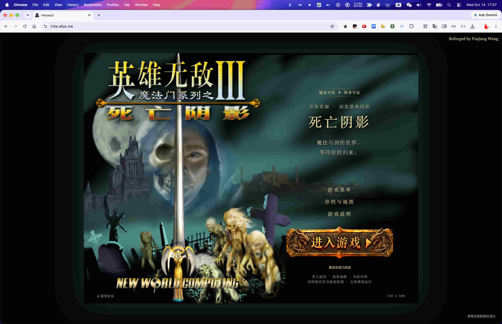

% Web版英雄无敌3死亡阴影三合一上线啦～
% 王福强
% 2026-10-14

缘起老夏说，他想玩quake了，他想玩英雄无敌了...

（哎呀，怎么有点儿创世主说there let be light的意思呢？）

然后就有了第一版H3-Friends-Local-20261004-r2

然后他就发给我了

说有需要自己随便改

然后我十一假期那段时间就开始捣鼓了...

改了差不多七八版吧

从本地版改成了完全在线版

本地版主要修复了几个问题：

- 一个是双C施法，老夏给我的版本去掉了，我让codex又修复了这个经典bug，但这货干活儿现在挺墨迹的，让它自己搜社区了解细节，它搞不定，我只能一步一步地教他什么是原汁原味的双C交互🤣
- 另外就是存档策略： 原来的存档策略有点儿类似WAL的机制（不知道WAL是啥的忽略，纯分布式系统场景的技术术语），所以，磁盘占用持续飙升，主要是它每次都全量备份，所以，我有点儿受不了了，因为发现磁盘不知道咋的少了几十G，查了下才发现是游戏本地存档搞出来的。 添加了设置选项，让用户自己决定要不要用这种策略，默认关闭，只存增量。

转成在线版后修复的主要问题是：

- 内存泄漏： 对，第一版在线版内存泄漏，导致一分钟之后游戏卡顿，让codex查了下，发现是游戏引擎转码过程中有个逻辑会导致创建的对象不回收，短时间内内存会从几百兆直接飙升到1.2G， 而浏览器分配给每个tab的资源显然没那么多，所以，直接卡顿甚至““死机”

剩下的几版改进都是细节上的，比如进入游戏主按钮，比如临时机器才需要用的完全清理，还有就是运维相关的增量上传，原来每次发布要上传七八百兆文件到服务器，大小倒是其次，主要是影响迭代效率，尤其是需要修小细节频繁发布的时候。

总之经历了差不多半个月的迭代之后

现在纯Web版的英雄无敌3死亡阴影上线可玩了

部署在[https://h3w.afoo.m](https://h3w.afoo.me)，暂时只是自己玩，并只开放给自己的付费群里的同学试玩， 主要是假如免费开放的话， 我怕我云账单的费用我吃不消🤣 突然来个账单刺客啥的我这小心脏受不了🤣

想玩的同学，可以自己去下载开源的VCMI引擎就可以了，h3w.afoo.me 也是基于这个引擎转换的，这个我就不藏着掖着了🤪

