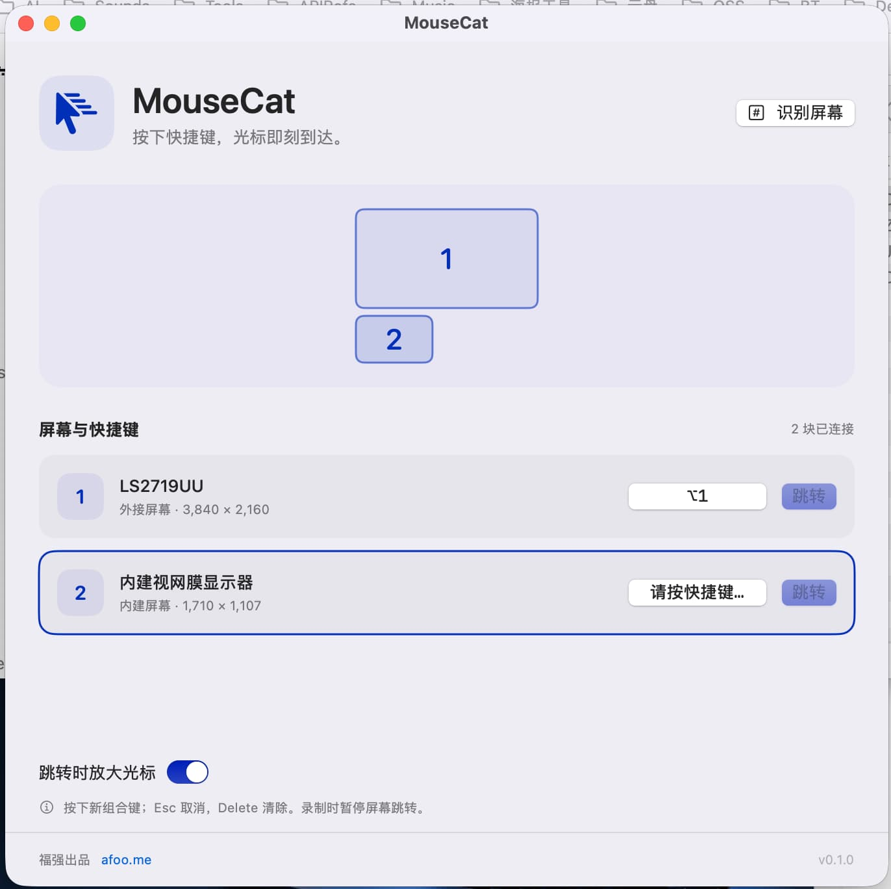
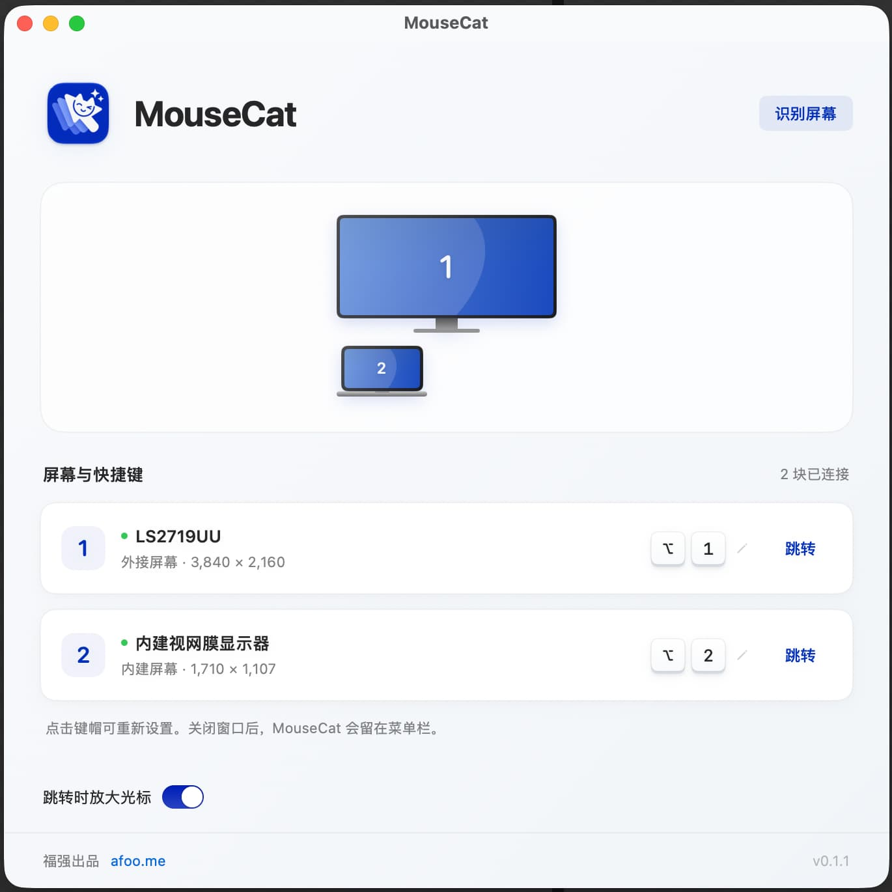

% MouseCat: 多屏幕之间一键跳转
% 王福强
% 2026-11-04

昨天在果总群里分享自己的作品集的时候，

盛总在群里说想要一个catchmouse那样的软件，

我之前没听说过这个软件

就google了一下（嗯，老习惯，但架不住人家现在也在头部提供AIGC啊🤣）

发现是一个macOS上使用的多屏幕之间快速移动鼠标的软件

虽然我有2-3块屏幕

但说实话，我大部分时间就只盯着一块屏幕

所以，对这个软件并没有那么强的需求

但鉴于昨天刚沉淀了一份个人用的macOS project setup 规范

正好用来练兵

最后，花了差不多半天时间，搞出了这个 MouseCat

是不是觉得很快？

嘿嘿

其实光看结果肯定觉得很 easy 啦

但任何一个产品

处理中间的过程细节才是最累人的

比如， 

前面几版我只让Agent专注核心功能了，

但UI层面我没有提要求，

所以，刚开始几版的界面是这样的：

后面功能稳定了

才开始着手打磨更高级质感的UI和UX

最后，

才是最终版本的这版MouseCat：

喜欢吗？

如果你有多屏幕，还使用macOS系统，快去下载试试吧？

<https://afoo.me/mousecat/>

最重要的， 免费～（It's FREE~)

